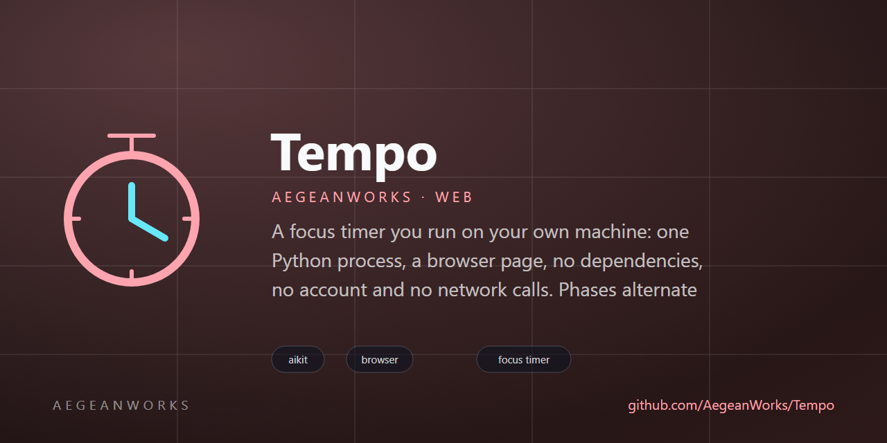

# tempo

<!-- aegean:media:start -->
<p align="center"></p>
<!-- aegean:media:end -->

[](https://github.com/AegeanWorks/AIKit)

A focus timer you run on your own machine: one Python process, a browser page, no
dependencies, no account and no network calls. Phases alternate focus and break, and
every fourth break is a long one.

## ⚡ 30-Second Cold-Start Quick Reference

- **Runtime Prerequisites**: Python 3.9+ (standard library only — nothing to install) and
  any modern browser.
- **Start it**:
  ```bash
  python run.py            # then open http://127.0.0.1:8765
  ```
- **Canonical Regression Shield Gate**:
  ```bash
  python -m unittest discover -s tests -t .
  ```
- **UI inventory proof** (the snapshot the UI guard compares against):
  ```bash
  python tools/ui_inventory.py
  ```
- **Dogfood gate** (starts the real server, drives it, then attacks it):
  ```bash
  python tools/dogfood.py
  ```

### 🛠️ AIKit Commands (run from the AIKit folder)
| Role | Command |
|---|---|
| Status, task and gates | `python aikit.py status tempo` |
| Phase 4: every gate | `python aikit.py check tempo` |
| Repair memory and map, then check | `python aikit.py fix tempo` |
| Resume an interrupted task | `python aikit.py resume tempo` |
| Open a bounded UI task | `python aikit.py ui begin tempo "<what>"` |
| Check scope, proofs and style | `python aikit.py ui verify tempo` |

## 📦 What's Inside

```text
tempo/
├── run.py                    <- entry point: flags, port, phase lengths
├── tempo/
│   ├── __init__.py           <- package marker
│   ├── phases.py             <- the phase sequence and its durations (pure)
│   ├── session.py            <- session state and its transitions (pure)
│   ├── status.py             <- the flat read model the UI renders
│   ├── store.py              <- atomic, power-loss-safe session file
│   └── server.py             <- stdlib HTTP: web/ plus two JSON endpoints
├── web/
│   ├── index.html            <- the page: controls, live regions, roles
│   ├── theme.css             <- every colour, font and token (the only theme path)
│   ├── app.css               <- layout only: box model, flow, spacing
│   └── app.js                <- polls status, posts one named action per button
├── tools/
│   ├── __init__.py           <- package marker
│   ├── ui_inventory.py       <- prints the UI inventory, one entry per line
│   └── dogfood.py            <- runs and attacks the real app (PRINCIPLE-015)
├── tests/
│   ├── __init__.py           <- package marker
│   ├── test_session.py       <- phase plan, transitions, read model
│   ├── test_store.py         <- round trip, schema refusal, quarantine
│   ├── test_app.py           <- backend contract and static path safety
│   └── test_http.py          <- real socket: endpoints, assets, 400s and 404s
├── .gitignore                <- transient state and caches excluded
├── README.md
├── COMMERCIAL.md
├── LICENSE
├── LICENSES/                 <- REUSE license texts
├── REUSE.toml                <- Machine-readable SPDX metadata
└── .aikit/                   <- this project's memory: record, ledger, decisions
```

## 🎛️ Using it

| Control | What it does |
|---|---|
| **Start / Pause** | Runs or banks the current phase. Space does the same. |
| **Skip phase** | Moves to the next phase; a skipped focus phase still counts. |
| **Reset** | Back to a paused first focus phase, cycle count cleared. |
| **Sound on / off** | Toggles synthesized Web Audio chimes on phase completion (zero audio assets). |
| **Settings** | Opens interval dialog to customize focus, break, and cycle lengths live. |
| **Analytics** | Displays today's completed focus intervals and cumulative focused time. |

Flags: `--port`, `--state`, `--focus`, `--short-break`, `--long-break`, `--cycle`
(minutes, except `--cycle`, which counts focus phases before a long break). Bad values
exit 2 with a `Why:` and a `Fix:`; a taken port exits 1.

## 🧭 How it is put together

The timer owns no clock. `session.py` takes `now` as an argument and returns new frozen
states, so every rule is testable without sleeping. `settled()` advances past phases that
elapsed between two polls and carries the overshoot forward, which is why the browser can
poll once a second — or once a minute — and still land on the right phase.

The server settles, persists and reports; the page only renders what it is given. All
colour and type live in `web/theme.css`, so a hardcoded colour anywhere else in `web/` is
a style-drift finding rather than a matter of taste.

### State and crashes

`state/session.json` is written to a temporary sibling, flushed, fsynced and moved into
place, so a power loss leaves the old file or the new one, never half of each. The file
carries a schema version: a version this build does not know is refused untouched, and an
unreadable file is moved to `session.json.corrupt` and replaced by a fresh session.

<!-- aegean:brand-assets:start -->
## 🎨 Brand Assets

> **AI-Generated Brand Artwork.** The banner and logo are **AI-generated brand assets**. They are illustrative and may not literally depict every feature or the full project scope.
<!-- aegean:brand-assets:end -->

## 📜 License

Free for personal use under the Aegean License 1.1 (AL-1.1); see [LICENSE](LICENSE). Any commercial use needs the Aegean Commercial License 1.0 (ACL-1.0); see [COMMERCIAL.md](COMMERCIAL.md).
